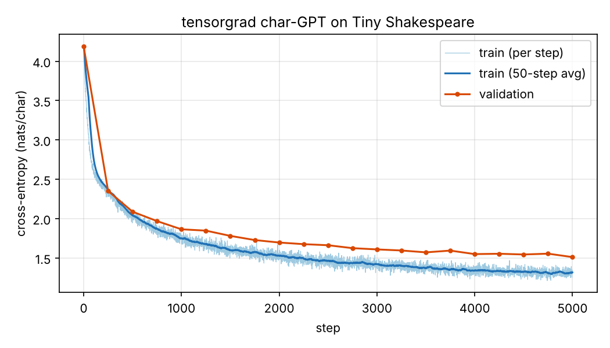

# tensorgrad

A reverse-mode automatic differentiation engine written from scratch in Python + NumPy,
and a small character-level GPT trained with it on Tiny Shakespeare.

No PyTorch or JAX in the library: `tensorgrad/` imports only `numpy` and the standard
library (a test enforces this). PyTorch appears only in the test suite, as an optional
reference implementation.

<p align="center"></p>

## Quick start

```bash
pip install -r requirements.txt     # numpy, pytest, matplotlib
pip install torch                   # optional: enables the torch-parity tests
```

```bash
python -m pytest -q                 # 139 tests
```

```bash
python sample.py --prompt "ROMEO:"  # generate from the included checkpoint
```

```bash
python train.py                     # retrain from scratch (~22 min on 4 CPU cores)
```

```bash
python plot.py                      # assets/loss.csv -> assets/loss.png
```

`train.py` downloads Tiny Shakespeare to `data/input.txt` on first run (falling back to
Project Gutenberg's complete works), logs every step to `assets/loss.csv`, and writes the
checkpoint to `assets/model.npz`. Run any script with `--help` for its options.

## Architecture

```
tensorgrad/
  value.py    scalar engine (M1 warm-up, micrograd-style)
  tensor.py   Tensor: ndarray + graph bookkeeping, backward(), topological sort, no_grad()
  ops.py      primitive ops and their gradients, plus fused softmax / cross-entropy / layer_norm
  nn.py       Module, Linear, Embedding, LayerNorm, CausalSelfAttention, MLP, Block, GPT
  optim.py    SGD, AdamW, global-norm gradient clipping, warmup + cosine LR
  data.py     char tokenizer, dataset download, batching
train.py  sample.py  plot.py
tests/
```

**The engine.** A `Tensor` holds an `np.ndarray`, an optional `.grad`, its parent tensors and
a `_backward` function. Every op in `ops.py` follows one pattern: compute the forward value
with NumPy, then return `Tensor._make(value, parents, backward)`, where `backward(g)` maps the
upstream gradient `dL/d(out)` to one gradient per parent. `Tensor.backward()` orders the
graph topologically (iteratively, so deep graphs don't hit Python's recursion limit), then
walks it in reverse and **accumulates** each parent's gradient, so a tensor used several times
receives the sum of its contributions. Ops never write to `.grad` themselves. The engine also
asserts that every gradient has its parent's shape, which catches broadcasting bugs at
the op that caused them.

**Ops.** add, sub, mul, div, neg, pow, batched/broadcast matmul, sum/mean/max over any
axes (with `keepdims`), exp, log, tanh, relu, GELU (tanh approximation), reshape,
transpose/permute, indexing/gather (`np.add.at`, so repeated embedding indices accumulate),
concat, masked_fill and where. Broadcasting is undone in backward by `unbroadcast`, which sums
the gradient over the axes broadcasting added or stretched.

**Fused ops.** `softmax`, `log_softmax` and `cross_entropy` subtract the row max before
exponentiating. `cross_entropy` and `layer_norm` have hand-derived backward passes instead of
being composed from primitives: fewer graph nodes, less memory, and they stay numerically
stable for large logits.

**The model.** A GPT-2-style decoder: token + learned positional embeddings, `n_layer`
pre-LayerNorm blocks (causal multi-head self-attention, then a 4x GELU MLP, each wrapped in
a residual connection), a final LayerNorm and a linear LM head. Weights are initialized from
N(0, 0.02), with residual output projections scaled by 1/sqrt(2·n_layer). Attention is
composed from primitives: `q @ kᵀ / sqrt(d)`, `masked_fill` with `-inf` above the diagonal,
fused `softmax`, then `@ v`.

**Training.** AdamW (β = 0.9, 0.99; decoupled weight decay 0.1 on matrices only, none on
biases/LayerNorm), gradient clipping at global norm 1.0, linear warmup then cosine decay
from 1e-3 to 1e-4. Parameters are float32 for speed; the tests run everything in float64.

## Results

| | |
|---|---|
| Model | 4 layers, 4 heads, d_model 128, context 64, 818,176 parameters |
| Data | Tiny Shakespeare, 1.1M characters, 65-char vocab, 90/10 train/val split |
| Training | 5,000 steps × batch 32 × 64 chars ≈ 10.2M characters |
| Hardware | 4 vCPUs of an Intel Xeon @ 2.1 GHz (cloud VM), no GPU |
| Time | 21.5 min (0.26 s/step, NumPy 2.5.3, Python 3.13.18) |
| Final loss | train ≈ 1.31, val 1.51 nats/char (uniform guessing: ln 65 = 4.17) |

Sample (`python sample.py --seed 0 --tokens 600`, temperature 0.8; full text in
[`assets/sample.txt`](assets/sample.txt)):

```
Madam:
Thou talk, for the young brother night?

BUCKINGHAM:
I bear your husband their substicsly would the watch;
Something entoice the strange of thine inquest in?

DUKE VINCENTIO:
Are not for yourself, my country high: I am lensed
Were my worse: I'll see, the shall bastardy myself,
She come in this appoint and part them slander
Of the law of his: and her doth a mating straight
Whose this to the duke you love your grace, so not once
Even some father's father's castian appeal,
Most me in the wisdoph of writterly land Hereformer beat
To make this father's shall be heard to speak.

CAMILLO:
Sir,
```

## How correctness is verified

The suite has 139 tests (`python -m pytest -q`, about 20 s). Every gradient is checked two
independent ways:

1. **Finite-difference gradchecks.** `tests/gradcheck.py` reduces an op's output to a scalar
   with fixed random weights, `L = sum(out * w)`, so every output element matters, then
   compares the analytic gradient of every input against central differences
   `(L(x+ε) − L(x−ε)) / 2ε` with ε = 1e-6 in float64 (rtol 1e-5). This runs for:
   - every primitive op (44 cases), including broadcasting on both operands, keepdims
     broadcasting, batched and broadcast matmul, repeated gather indices, and tensors reused
     several times in one graph;
   - every fused op, which is additionally checked against the same function **composed
     from primitives**, for both value and gradient;
   - **a whole GPT end to end** (vocab 5, d 8, seq 4), every parameter;
   - the scalar `Value` engine.
2. **PyTorch parity** (skipped if torch isn't installed). The same op table runs forward and
   backward through torch and must match to ~1e-10. The full GPT is also rebuilt functionally
   in torch from our weights (using `F.scaled_dot_product_attention`); logits, loss and every
   parameter gradient must match. AdamW and SGD-with-momentum must track
   `torch.optim` over 10 steps.

Behavioural tests cover the rest: changing a future token never changes earlier logits
(causality); the model memorizes a single batch to loss < 0.05; logits of 1000 don't
overflow; save/load round-trips; leaf gradients accumulate across `backward()` calls; float32
inputs stay float32; and the train → sample → plot pipeline runs end to end on a tiny config.

## Limitations

- **CPU only, and slow.** Speed is whatever NumPy's BLAS gives, plus Python overhead per
  op: no GPU and no kernel fusion beyond the hand-fused ops. A training step at this model
  size takes ~0.26 s.
- **No higher-order gradients.** Backward functions operate on raw arrays, so the gradient
  computation is not itself differentiable.
- **No dropout, no weight tying, no KV cache.** `generate()` recomputes the full context for
  every token.
- **Minimal API.** `pow` with a tensor exponent assumes a positive base; `matmul` requires both
  operands to have ≥ 2 dims; intermediate `.grad`s are not retained (only leaves get `.grad`).
- **Small model, small data.** The model learns the spelling, layout and rhythm of
  Shakespeare, but not much meaning. Validation loss is still falling at the end of the run.

## Derivations

### Backprop through broadcasting

TODO(Will)

### Softmax + cross-entropy

TODO(Will)

### LayerNorm backward

TODO(Will)

### Attention backward

TODO(Will)
